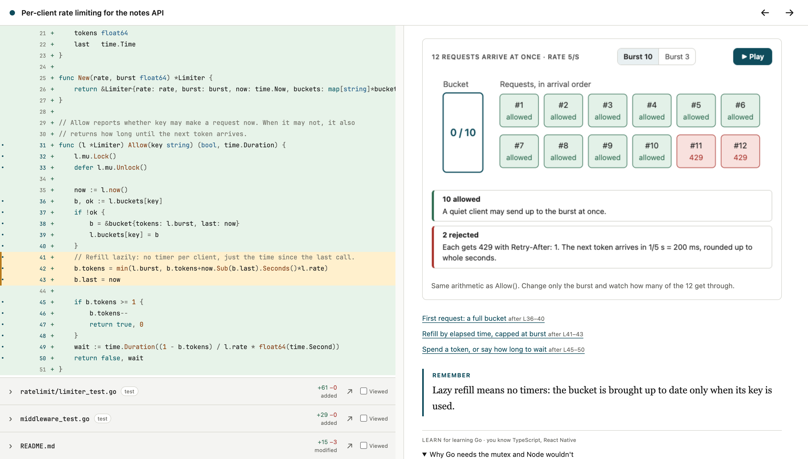
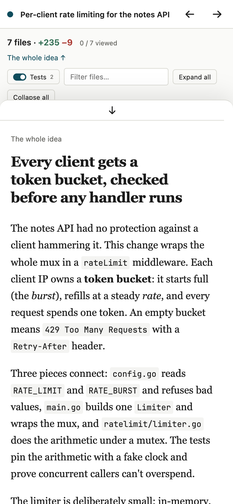

# Throughline

Your agent wrote the change. Throughline helps you understand it well enough to debug it and defend it in review.

Throughline is an agent skill. You ask "walk me through my changes in Throughline", and your agent writes a walkthrough of the git change. It then opens a single HTML file:

- **Left pane:** the full diff, VS Code style. Each changed file is a collapsible section, ordered the way the explanation flows. Files the walkthrough skips come last, under "Not explained".
- **Right pane:** with no file selected, *the whole idea*. That covers what changed and why, interactive diagrams, the decisions to defend, a Remember line and a quiz. Select a file to read its explanation, with line links that highlight the diff and Learn notes for the language you're learning.





**Try the demo.** Open [`examples/rate-limiter/throughline.html`](examples/rate-limiter/throughline.html) in a browser after cloning (GitHub shows the file's source, not the page). It walks through a made-up Go notes API gaining a per-client rate limiter.

**The reader has:**
- GitHub-style totals (`7 files · +235 −9`), with a breakdown by repo when a change spans several;
- a **Tests** toggle that hides test files, shows totals without them, and makes `j`/`k` skip them;
- per-file **Viewed** checkboxes, remembered in your browser for each change;
- a path filter, plus expand all and collapse all;
- keys: `j`/`k` or `←`/`→` move through files in flow order, `x` marks the file viewed, `Esc` goes back to the whole idea;
- an "open in editor" link (`vscode://file/…:line`) on every file;
- a phone layout, where the explanation rises as a sheet over the diff.

<br clear="right">

## Install

```sh
npx skills add kabeerx9/throughline
```

The [`skills`](https://github.com/vercel-labs/skills) CLI installs `skills/throughline` for Claude Code, Codex and other agents. You can also copy that folder by hand into `~/.claude/skills/` or `~/.agents/skills/`. The scripts need Node 18 or later and have no dependencies.

## Use

Ask your agent:

> Walk me through my changes in Throughline.

Some variations:
- "Explain the last 3 commits with Throughline."
- "Throughline this branch against `origin/main`."
- "Walk me through the change across `../api` and `../web`."

The agent tells you where it wrote `throughline.html`, and the page opens in your browser. It works offline from `file://`, with no server.

## How it works

```
capture.mjs ──> change.json ──┐
                              ├──> show.mjs ──> throughline.html (viewer + data, one file)
agent writes walkthrough.json ┘        └── validate.mjs (strict; errors name the JSON path)
```

1. **`scripts/capture.mjs` snapshots the change** into `change.json`: per-repo roots and refs, and per file the status, `+`/`−` counts, an `isTest` guess and full hunks with line numbers.
   - By default it captures uncommitted work, untracked files included. With none, it compares the branch with its merge base on the default branch.
   - `--base`, `--commits`, `--staged` and `--unstaged` override that.
   - Pass several repos to get one bundle, with paths prefixed by repo name.
   - Binary files and lockfiles keep their stats but not their bodies.
2. **The agent writes `walkthrough.json`:** an overview, then file explanations in flow order. [`reference/format.md`](skills/throughline/reference/format.md) defines the format.
3. **`scripts/show.mjs` validates the walkthrough and renders the page.** The validator rejects:
   - unknown keys;
   - paths that aren't in the change;
   - line references outside the diff;
   - bad quiz answer indexes;
   - notes over their caps.

   `show.mjs` then inlines both JSON files and the reader profile into the prebuilt `viewer/viewer.html`, and opens the result.

Output goes to `<repo>/.git/throughline/<id>/`, so your working tree stays clean (`--out <dir>` overrides this). The id is a hash of the change: capturing the same change again reuses it, and your Viewed checkboxes survive.

**Diagrams.** Diagrams are hand-written SVG and small vanilla JS in the style of visual lessons: one toggle flips one variable, and a Play button animates. Each runs in an `<iframe sandbox="allow-scripts">` with no same-origin access and a CSP that blocks network access. A diagram can't read the page, its storage or the network. The only message the parent accepts from it is a size update.

## Token cost

The agent's context is the scarce resource, so each step costs as little as possible:
- **The skill:** `SKILL.md` is about 540 tokens. The frontmatter description is the only part loaded before the skill triggers.
- **Capture:** stdout is one line per file plus the totals, about 15 tokens per file. It never prints hunks.
- **Diffs:** the agent pulls only the files it needs, with `capture.mjs --show <path>`. Each call is capped at 160 rows and prints a `--from` hint to continue.
- **The format:** `reference/format.md` (about 1,700 tokens) is read once, only when writing.
- **Rendering:** the diff and the viewer go into the HTML, never through the agent.

## Reader profile and Learn notes

```sh
node ~/.claude/skills/throughline/scripts/profile.mjs --knows "TypeScript, React Native" --learning "Go, Redis"
node ~/.claude/skills/throughline/scripts/profile.mjs        # prints it in one line
```

The profile is stored in `~/.config/throughline/profile.json` (`$XDG_CONFIG_HOME` and `$THROUGHLINE_CONFIG_DIR` are honoured). The agent adds Learn notes only for topics on your `learning` list that appear in the diff. A note shows the idiom in the new language beside the same task in one you know, and can highlight the lines it refers to. Each file or overview has at most three notes.

## Development

```sh
npm install
npm run build      # viewer-src -> skills/throughline/viewer/viewer.html, then the demo
npm test           # capture, validator, show, profile and viewer logic (Node 22.18+)
npm run test:e2e   # a fresh install driven in your local Chrome (playwright-core, channel "chrome")
npm run typecheck
```

- `viewer-src/` is Vite + Preact, built into one file with `vite-plugin-singlefile`.
- `examples/build-demo.mjs` replays `before/` → `after/` in a scratch repo, captures it with the skill's own script, and renders the demo.
- `npm run test:e2e -- --readme` refreshes the screenshots in `docs/`.

## License

MIT © Kabeer Joshi
